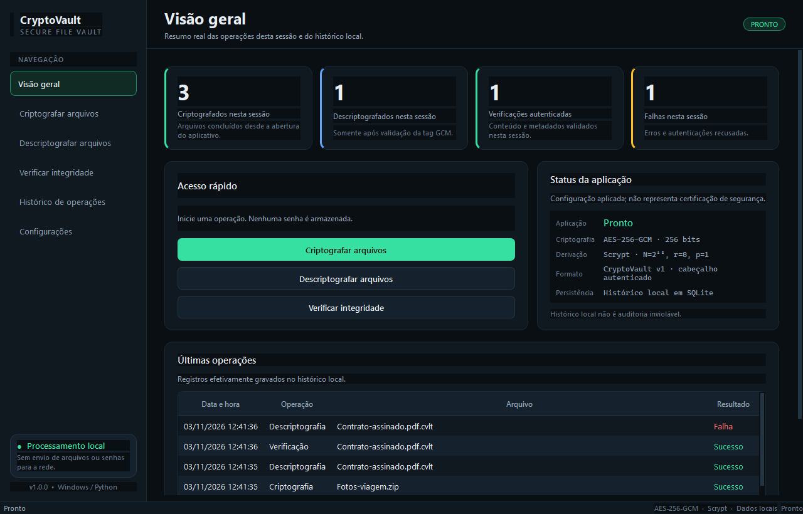
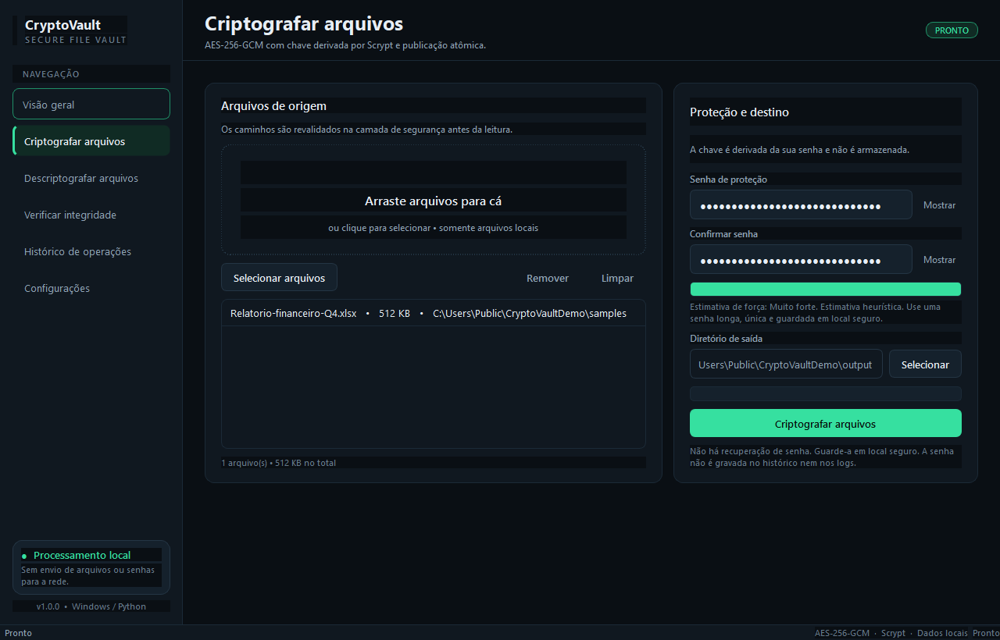
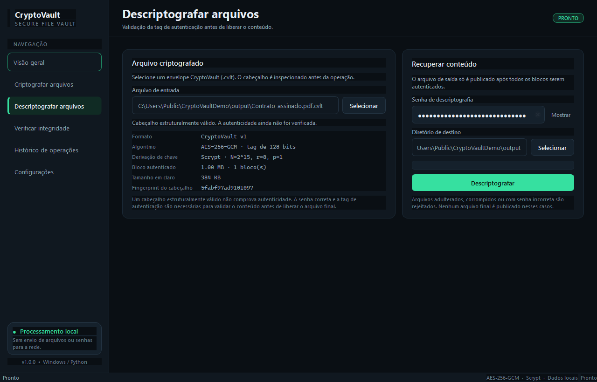
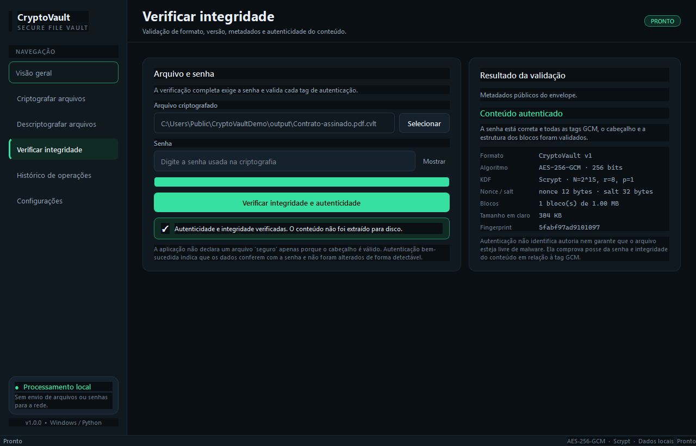
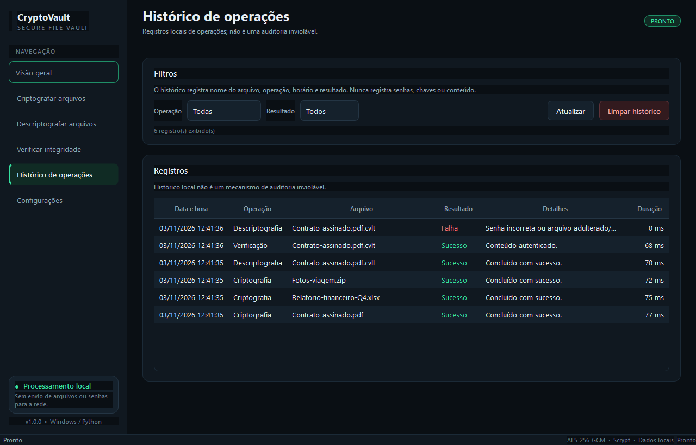
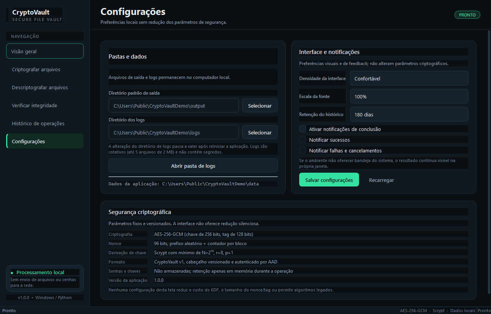

# CryptoVault Desktop

Aplicativo desktop local, em português-BR, para criptografar, descriptografar e
verificar arquivos com **AES-256-GCM**, chave derivada por **Scrypt** e
publicação atômica de saída.



> **Versão 1.0.0** · Windows · Python 3.12+ · PySide6 · `cryptography`

## Visão geral

O CryptoVault Desktop protege arquivos em repouso sem enviar dados para a rede.
O aplicativo usa um formato binário versionado próprio (`CryptoVault v1`,
extensão `.cvlt`), autentica cabeçalho e conteúdo, processa arquivos em blocos de
1 MiB e só publica o arquivo final depois que **todos** os blocos forem
autenticados.

O projeto é uma aplicação funcional, não um protótipo visual: a interface é
integrada ao mesmo motor criptográfico exercitado pela suíte de testes e pelo
self-test do executável.

## Funcionalidades

- **Criptografar** um ou vários arquivos com senha e confirmação.
- **Descriptografar** somente após validar a tag GCM de cada bloco.
- **Verificar** formato, versão, limites de KDF, metadados e autenticidade do
  conteúdo sem extrair o arquivo para disco.
- **Histórico local** em SQLite com filtros por operação e resultado.
- **Dashboard** com estatísticas reais da sessão e últimas operações.
- **Configurações** de pastas, densidade, escala de fonte, notificações e
  retenção do histórico — sem opções que reduzam parâmetros criptográficos.
- Arrastar e soltar, seletor de arquivos, senha com revelação temporária,
  estimativa heurística de força, progresso, cancelamento seguro e atalhos.
- Processamento em worker dedicado (`QThreadPool`), mantendo a interface
  responsiva.
- Instância única por usuário, logs JSON rotativos e sanitizados, nenhum
  caminho completo, senha, chave ou conteúdo nos logs.
- Teste interno (`--self-test`) executável sem abrir a interface, útil para
  validar o binário empacotado.

## Capturas de tela

| Criptografia | Descriptografia |
| --- | --- |
|  |  |

| Verificação autenticada | Histórico |
| --- | --- |
|  |  |



As capturas foram geradas pelo script `scripts/generate_screenshots.py` a partir
de operações criptográficas reais, em uma sessão isolada.

## Segurança em resumo

| Item | Escolha |
| --- | --- |
| Cifra | AES-256-GCM (tag de 128 bits) |
| Derivação | Scrypt, mínimo `N=2^15`, `r=8`, `p=1`, salt de 32 bytes |
| Nonce | 96 bits: prefixo aleatório de 8 bytes + contador de 32 bits |
| Blocos | 1 MiB, cada um com AAD próprio |
| AAD | Cabeçalho completo + índice + tamanho em claro + marcador final |
| Saída | Arquivo temporário no destino, `fsync`, publicação atômica sem sobrescrever |
| Falha/cancelamento | Temporário removido; nenhum conteúdo parcial publicado |
| Senhas | Não armazenadas; buffer mutável com limpeza explícita em melhor esforço |
| Histórico/logs | Sem senhas, chaves, conteúdo ou caminhos completos |

O formato, os limites e as decisões criptográficas estão detalhados em
[CRYPTOGRAPHY.md](CRYPTOGRAPHY.md). Limitações e modelo de ameaças estão em
[SECURITY.md](SECURITY.md) e [THREAT_MODEL.md](THREAT_MODEL.md).

## Requisitos

- Windows 10/11 (principal), Linux/macOS para desenvolvimento.
- Python **3.12 ou 3.13**.
- PySide6 6.9.3+ e `cryptography` 50.0.2+.

O ambiente de validação usado neste projeto foi **Windows 11, Python 3.13.17,
PySide6 6.9.3, cryptography 50.0.2**.

## Instalação e execução

### Aplicativo instalado (recomendado)

Baixe o pacote em [Releases](https://github.com/Mersfik/cryptovault-desktop/releases)
e escolha uma das opções:

**1. Instalador Inno Setup** — `CryptoVault-Desktop-1.0.0-setup.exe`

- Instala em `%LOCALAPPDATA%\Programs\CryptoVault Desktop` (por usuário, sem
  privilégios administrativos).
- Cria atalho no Menu Iniciar e oferece o atalho da Área de Trabalho como opção.
- Registra a desinstalação em **Configurações → Aplicativos**.
- Preserva `%LOCALAPPDATA%\CryptoVault` na desinstalação.

**2. Instalador por script** — `install.cmd` (ou `install.ps1`), no pacote Windows

Use esta opção se o Smart App Control do Windows bloquear o instalador. Ela
produz o mesmo resultado (arquivos, atalhos, entrada em Aplicativos e
desinstalador), sem executar nenhum binário de instalação:

```powershell
# duplo clique em install.cmd, ou:
powershell -NoProfile -ExecutionPolicy Bypass -File .\install.ps1

# sem atalho na Área de Trabalho:
powershell -NoProfile -ExecutionPolicy Bypass -File .\install.ps1 -NoDesktopShortcut
```

**3. Executável portátil** — `CryptoVault.exe`

Rode diretamente de qualquer pasta, sem instalar. Não cria atalhos. Para ter um
atalho apontando para o portátil:

```powershell
powershell -ExecutionPolicy Bypass -File scripts\create_shortcut.ps1 `
  -Target "C:\caminho\CryptoVault.exe" -Location Both
```

### Desinstalação

- Instalador Inno Setup: **Configurações → Aplicativos → CryptoVault Desktop**.
- Instalador por script: mesmo caminho em Aplicativos, ou
  `%LOCALAPPDATA%\Programs\CryptoVault Desktop\uninstall.ps1`
  (`-RemoveUserData` apaga também histórico e configurações).

Nenhuma das opções remove `%LOCALAPPDATA%\CryptoVault` por padrão.

### Executar a partir do código-fonte

```powershell
python -m venv .venv
.\.venv\Scripts\Activate.ps1
python -m pip install --upgrade pip
python -m pip install -e ".[dev]"
python -m cryptovault
```

Também é possível executar como módulo:

```powershell
python -m cryptovault --data-dir "C:\dados\CryptoVault"
```

Opções úteis:

```text
--data-dir DIR    diretório de dados local (histórico, configurações, logs)
--version         exibe a versão
--self-test       executa o teste criptográfico interno
--report ARQUIVO  grava o resultado do self-test em JSON
```

O diretório padrão de dados é `%LOCALAPPDATA%\CryptoVault`; ele pode ser
sobrescrito pela variável `CRYPTOVAULT_DATA_DIR` ou por `--data-dir`.
O diretório padrão de saída é `Documentos\CryptoVault` e pode ser alterado nas
configurações.

## Como usar

1. Abra **Criptografar arquivos**, selecione um ou mais arquivos, informe e
   confirme uma senha, escolha a pasta de saída e clique em **Criptografar**.
2. Guarde a senha em local seguro. **Não há recuperação de senha.**
3. Para recuperar, abra **Descriptografar arquivos**, selecione o `.cvlt`,
   informe a senha e escolha o destino. O arquivo só aparece se a autenticação
   de todos os blocos passar.
4. Use **Verificar integridade** para validar um envelope sem gravar o conteúdo
   em claro.
5. O **Histórico** registra nome do arquivo, operação, horário, resultado,
   tamanho e duração. Ele não é um registro de auditoria inviolável.

## Build do executável e do instalador

```powershell
# apenas o executável
powershell -ExecutionPolicy Bypass -File scripts/build_windows.ps1

# executável + instalador Inno Setup
powershell -ExecutionPolicy Bypass -File scripts/build_installer.ps1
```

`build_windows.ps1`:

1. gera `cryptovault/resources/logo.ico` e `logo.png`;
2. executa PyInstaller com `CryptoVault.spec` (one-file, sem console, ícone e
   metadados de versão do Windows vindos de `installer/version_info.txt`);
3. roda `dist\CryptoVault.exe --self-test --report dist\self-test.json`;
4. grava `dist\CryptoVault.exe.sha256`.

`build_installer.ps1` chama o anterior e compila `installer/cryptovault.iss`
com o Inno Setup 6, gerando `release\CryptoVault-Desktop-1.0.0-setup.exe`.
O Inno Setup é opcional e pode ser instalado com:

```powershell
winget install --id JRSoftware.InnoSetup -e
```

Saídas esperadas: `dist\CryptoVault.exe`, `dist\self-test.json`, o checksum e,
com o Inno, o instalador em `release\`. Nenhum caminho absoluto do projeto fica
embutido nos artefatos.

O executável é **não assinado**; em ambientes corporativos, assine-o com o
certificado da organização antes da distribuição. Em máquinas com **Smart App
Control** ativo, instaladores não assinados podem ser bloqueados pelo Windows —
nesse caso use `install.cmd`, que não depende de nenhum executável de
instalação.

## Testes e análise estática

```powershell
python -m pytest -q
python -m pytest --cov=cryptovault --cov-report=term-missing
python -m ruff check .
python -m ruff format --check .
python -m bandit -r cryptovault -q
python -m pip_audit -r requirements.txt
```

Resultados reais da validação desta versão:

- **121 testes passaram, 4 foram ignorados** (semântica POSIX de permissões e
  criação de symlink indisponível no Windows).
- Cobertura de linhas/ramos em `cryptovault`: **83%** (excluindo `app.py` e
  `__main__.py`).
- Ruff: **sem erros**; formatação verificada.
- Bandit: **nenhum achado**.
- `pip-audit`: **nenhuma vulnerabilidade conhecida** nas dependências de
  execução.
- Self-test do código-fonte e do executável: **todos os checks verdadeiros**.

Os comandos e resultados também estão registrados em
[`docs/verification/`](docs/verification/).

## Estrutura do projeto

```text
cryptovault/
  crypto/          formato binário, KDF e motor AES-256-GCM
  domain/          modelos e erros de domínio
  security/        caminhos, segredos, redação e portão de concorrência
  application/     casos de uso e orquestração
  infrastructure/  SQLite, configurações e logging
  ui/              janela, páginas, widgets, tema e workers
  resources/       logo e ícones SVG/ICO/PNG
tests/             testes unitários, integração, segurança e UI
scripts/           geração de ícone, screenshots e build Windows
docs/              documentação, screenshots e evidências
CryptoVault.spec   configuração PyInstaller
```

## Documentação

- [ARCHITECTURE.md](ARCHITECTURE.md) — camadas, fluxos e concorrência.
- [CRYPTOGRAPHY.md](CRYPTOGRAPHY.md) — primitivas, formato e parâmetros.
- [THREAT_MODEL.md](THREAT_MODEL.md) — ativos, fronteiras e ameaças.
- [OWASP_MAPPING.md](OWASP_MAPPING.md) — mapeamento OWASP Top 10/ASVS.
- [SECURITY.md](SECURITY.md) — postura, limitações e relato de vulnerabilidades.
- [CONTRIBUTING.md](CONTRIBUTING.md) — desenvolvimento, testes e GitHub Actions.

## Limitações importantes

- Não há recuperação de senha, assinatura digital, autenticação de autoria ou
  prova de origem.
- O aplicativo não protege contra malware, keylogger, screen capture ou outro
  processo com os mesmos privilégios do usuário.
- A limpeza de memória e a sobrescrita de temporários são **melhor esforço**;
  Python, o sistema operacional, SSD/COW e backups podem reter cópias.
- Nomes de arquivo, tamanho aproximado e horários de operação não são
  confidenciais e aparecem no histórico local.
- O histórico SQLite é local e pode ser alterado por quem tiver acesso ao
  perfil do usuário; ele não é uma auditoria inviolável.
- Arquivos `.cvlt` são indistinguíveis de dados aleatórios sem a senha, mas o
  próprio envelope revela que se trata de um CryptoVault v1.
- O executável distribuído neste projeto não é assinado digitalmente.

Consulte [SECURITY.md](SECURITY.md) para a lista completa.

## Licença

MIT. Consulte [LICENSE](LICENSE).
